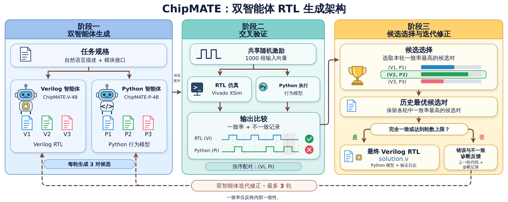
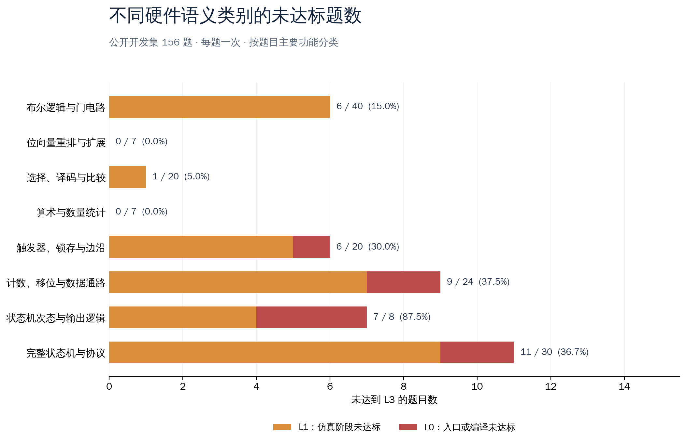
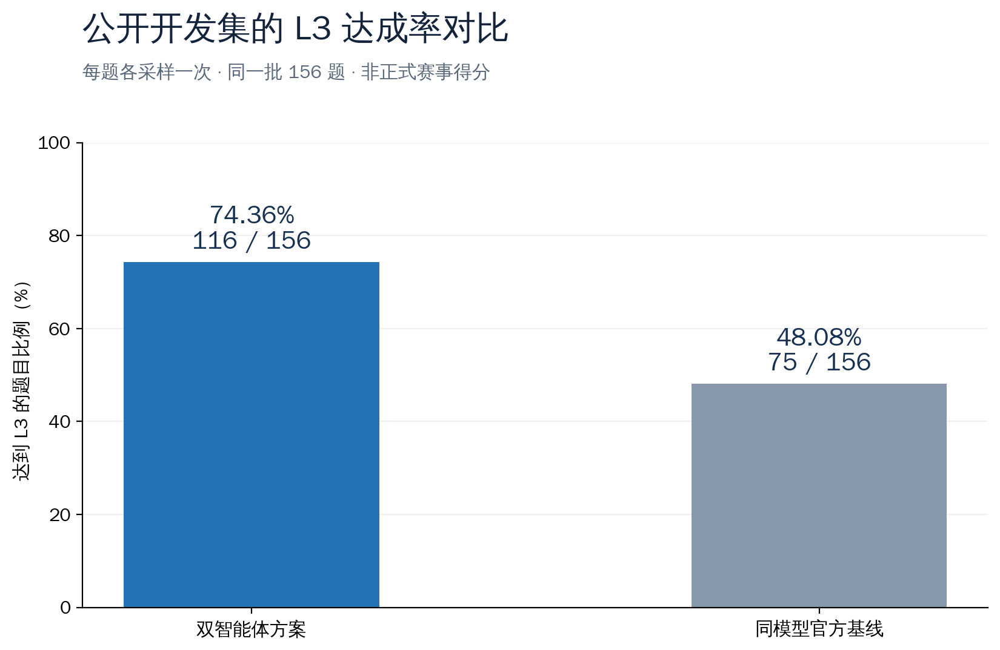

# RTL 智能体设计报告（草稿）

## 1. 方案概述

本方案面向自然语言硬件规格，生成可编译、可仿真和可综合的 RTL。设计思路是将任务的功能语义与硬件语言表达分工处理：一条路径负责把规格实现成 Verilog，另一条路径独立描述规格要求的行为，再通过交叉验证发现差异。方案同时保留赛事方原样的单模型基线，便于比较智能体流程带来的效果。

## 2. 总体架构

图中候选对的分数和高亮用于说明选择过程，并非具体题目的实测分数。

- **Verilog 智能体（V）**：生成符合模块接口、时序和语法要求的 RTL 候选。
- **Python 智能体（P）**：独立生成行为参考模型，侧重表达规格的功能语义。
- **交叉验证**：对两种实现施加相同随机输入，使用 Vivado XSim 仿真 RTL、执行 Python 行为模型，并比较输出。
- **选择与修正**：按一致率选择候选对，将不一致记录反馈给两个智能体；保留历史较优候选，在达到停止条件或轮数上限后输出 RTL。

这种分工将功能表达与 HDL 实现分开核对，但两个模型都可能误解同一条规格；交叉一致只说明内部一致，不能替代独立测试的通过结论。

## 3. 模型选择与训练来源

选择 ChipMATE-V-4B 和 ChipMATE-P-4B，是因为它们分别面向 Verilog 实现和 Python 参考模型生成，能够在同一规格下形成两种实现并互相检查；4B 级模型也便于在单卡资源预算内同时部署。两者基于 Qwen3.5-4B，使用 BF16、不量化。模型地址、完整版本号、上下文和显存配置见 `model/MODEL.md`。

ChipMATE 上游的训练过程先针对 Verilog 与 Python 任务分别训练两个智能体，再进行多智能体协作强化训练。本方案直接使用上游发布的权重，**本队没有重新训练或微调模型**。

当前模型文件获取需要接受访问条件，是否满足赛事方公开获取要求仍需确认；P 模型生成 Python 代码，其赛事规则分类也需确认。

## 4. 智能体控制流程

每轮生成 3 对候选，以 1000 组随机刺激进行交叉验证，最多 3 轮；不一致记录用于后续修正。单题入口为 `run.sh`，默认时间预算为 900 秒。若发生超时或工具错误，保留实际记录，不把内部一致率记作官方通过。

## 5. 技能与工具

方案保留 `skill/` 中的技能说明，当前默认配置不启用额外研究策略。RTL 仿真通过 Vivado 的 `xvlog`、`xelab`、`xsim` 完成；Python 行为模型在独立进程执行。任务参考实现和官方测试台只用于独立评测，不作为生成输入。

## 6. 硬件语义分类与开发集结果

### 6.1 数据口径与分类方法

本节使用同一批 156 道公开 VerilogEval 开发题：双智能体方案与同一 V 模型的官方单模型基线各生成一次，并由同一固定版本的 Vivado 评测工具独立判级。每题只保留一次结果；这是历史开发对照，不是赛事隐藏题成绩，也不是五次采样的稳定性结论。

历史对照采用原始 V/P 工作流；当前提交保留该生成与交叉验证算法，但其入口和部署封装经过后续整理，当前提交包没有重新跑完这 156 题。156 题均保留，包括下文单列的已知接口或评测条件问题。

根据题目描述的**主要硬件功能**，人工将每题归入一个类别；混合功能题按主要设计目标归类。类别划分存在一定主观性，但每题只计一次。完整的逐题类别、方案/基线等级和输入及判级文件 SHA256 见 [逐题分类表](analysis/case_taxonomy.csv)，汇总见 [分类统计表](analysis/category_summary.csv)。题目参考实现、测试台和历史结果不作为模型生成输入。

“未达 L3”表示未同时达到编译、功能仿真和综合的完整判级要求，包含模型错误、入口问题及已知评测条件限制；本次方案的 40 项未达 L3 中，32 项为 L1、8 项为 L0，没有 L2。下表不把这些结果全部归因于模型自身。

### 6.2 各硬件类别的未达标数量

分类包括：基础布尔逻辑；向量位序与扩展；选择/译码/比较；算术与数量统计；触发器/锁存/边沿；计数/移位/数据通路；仅生成次态和输出逻辑的状态机题；包含状态寄存器的完整状态机与协议题。

| 硬件语义类别 | 题数 | 方案未达 L3 | 未达 L3 比例 | 基线未达 L3 |
| --- | ---: | ---: | ---: | ---: |
| 布尔逻辑与门电路 | 40 | 6 | 15.0% | 18 |
| 位向量重排与扩展 | 7 | 0 | 0.0% | 3 |
| 选择、译码与比较 | 20 | 1 | 5.0% | 12 |
| 算术与数量统计 | 7 | 0 | 0.0% | 4 |
| 触发器、锁存与边沿 | 20 | 6 | 30.0% | 11 |
| 计数、移位与数据通路 | 24 | 9 | 37.5% | 13 |
| 状态机次态与输出逻辑 | 8 | 7 | 87.5% | 6 |
| 完整状态机与协议 | 30 | 11 | 36.7% | 14 |
| **合计** | **156** | **40** | **25.6%** | **81** |

完整状态机与协议的未达 L3 数量最多（11/30）；状态机次态/输出逻辑的比例最高（7/8），但后者样本仅 8 题，且含一项已确认的测试台接口冲突，不能简单解释为该类别的泛化错误率。计数、移位与数据通路为 9/24，反映多周期状态更新、位宽和边界条件是需要重点检查的方向。

### 6.3 总体 L3 达成率与基线对比

| 独立判级 | 双智能体方案 | 官方单模型基线 |
| --- | ---: | ---: |
| L3 | 116 | 75 |
| L2 | 0 | 0 |
| L1 | 32 | 40 |
| L0 | 8 | 41 |
| L3 达成率 | 74.36%（116/156） | 48.08%（75/156） |

同题配对后，63 题双方均达到 L3，53 题仅方案达到 L3，12 题仅基线达到 L3，28 题双方均未达到 L3；方案净多 41 题，差 26.28 个百分点。这是每题单次采样下的观察，不证明每个新增通过都由某一个环节独立造成。

另一次公开单题验证中，直接入口与模拟 HTTP 投题的方案均判 L3，基线均判 L1；双模型显存采样峰值约 28.38 GB。单题验证与上述 156 题历史对照是不同实验，不能合并计算成绩。

## 7. 运行与复现

在赛事环境准备好模型权重、工具和许可后，`serve/start.sh` 启动常驻模型；`run.sh <input_dir> <output_dir>` 运行方案，`run_baseline.sh` 使用相同模型服务运行官方基线。公网投题服务由 `serve/run_api.sh` 管理。赛事方提供的基础镜像及环境配置见 `Dockerfile` 与 `README.md`；模型权重不放入 Git 仓库。

## 8. 失败分析与典型案例

以下案例均来自第 6 节的固定单次开发运行。失配数为当次独立测试的观测，不等于不同题目之间可直接比较的难度指标。所列改进是后续验证方向，除特别说明外不代表已实施或已提升总体成绩。

文中的 CPU 微型反例使用 Icarus Verilog 做离线诊断，不构成新的官方判级；当前参赛流程与第 6 节独立判级使用 Vivado。

### 8.1 负沿触发被实现为双沿：Prob046_dff8p

**任务与结果。** 题目要求负沿触发、同步复位的寄存器。方案得到 L1，独立仿真 208/436 处失配；同题基线达到 L3。方案内部 V/P 一致率为 1.0。

**定位。** 生成的 RTL 同时在上升沿和下降沿更新，在题目不允许更新的上升沿也采样输入。公开规格构造的 CPU 微型反例复现了这一问题：完成复位后改变数据，上升沿本应保持，实际值却发生变化。内部一致率为 1 并未覆盖或否定这个反例。

**后续方向。** 将有效沿、复位优先级和非有效沿保持作为独立验证点；对明确负沿题补充对应刺激。此前某负沿专门化版本有独立样本成功记录，但不能把不同版本的结果合并为本次默认方案成绩。

### 8.2 时序保持误写成组合逻辑：Prob098_circuit7

**任务与结果。** 题目根据波形实现正沿更新的时序电路。方案为 L1，63/123 处失配；基线为 L3，方案内部一致率为 1.0。

**定位。** 原 RTL 写成输入的组合反相，未使用时钟；Python 模型也在时钟判断前更新输出。两个实现因此可能同时忽略保持语义，形成“双方一致但都不满足规格”。时钟低电平期间改变输入的 CPU 微型反例复现了输出不应即时变化的问题。

**后续方向。** 对波形题分别检查采样沿、沿间保持、锁存透明区间；将公开波形约束作为独立检查，而不是只依赖 V/P 互相对拍。

### 8.3 K-map 单个表项错误：Prob113_2012_q1g

**任务与结果。** 四输入 Karnaugh 图要求实现组合函数。方案和基线均为 L1；方案独立仿真 4/100 处失配。

**定位。** 公开表格的行列顺序与信号位序需要共同解释。原候选在一个明确输入组合上输出与表项不符；公开规格构造的 CPU 反例复现了该单点差异。这不是整个函数都错误，而是少数输入即可使整题未达 L3。

**后续方向。** 对小规模组合规格按公开的行列和 Gray 编码逐项检查，给模型反馈明确反例，并重新检查全部表项。已尝试过相关局部修复，但尚不能据此声称默认方案或全量结果得到改善。

### 8.4 协议完成状态不可达：Prob128_fsm_ps2

**任务与结果。** 题目要求识别连续三字节消息。方案为 L1，90/400 处失配；基线为 L3；方案内部一致率为 1.0。

**定位。** 原状态转移在第二字节后返回前一状态，负责产生完成信号的状态不可达，导致完成信号始终无效；Python 模型也出现同类不可达状态。公开协议微型反例送入完整消息后未观察到应有完成信号。

**后续方向。** 验证每个输出状态的可达性、字节计数和背靠背包；区分第一字节的同步条件与后续数据位。检查器只提供反例和诊断，生成实现仍由模型完成。

### 8.5 多级计数与评测时限：Prob141_count_clock

**任务与结果。** 题目要求实现带 AM/PM 的 12 小时 BCD 时钟。方案和基线均为 L1；方案在当次测试中出现 199998/199999 处失配。

**定位。** 原候选复位小时值不符合规格，且分钟、小时进位和 AM/PM 保持逻辑存在问题。单独的参考实现控制虽为零失配，但当前测试台仍打印 TIMEOUT：这是另一个评测终止条件限制，不能用它掩盖模型本身的实际错误，也不修改原始等级。

**后续方向。** 分别覆盖复位、使能保持、秒分进位、11→12、12→01 和 AM/PM 切换，并把测试台终止条件与模型功能分开验证。

### 8.6 保留字导致编译失败：Prob146_fsm_serialdata

**任务与结果。** 题目要求串行接收与字节输出。方案为 L0，未进入有效功能仿真；基线为 L3。

**定位。** 生成 RTL 使用 SystemVerilog 保留字作为变量名，Vivado 报告语法错误。即使改正名称，数据位方向、停止位处理和完成信号仍需独立验证，不能据此直接宣称达到 L3。

**后续方向。** 将编译器诊断反馈给模型进行最小修复，再用起始位、数据位、停止位和异常恢复等序列覆盖语义。

### 8.7 共性问题与数据边界

上述案例集中暴露四类问题：时钟边沿和保持语义遗漏；状态机状态可达性及输出时机错误；位序、表格映射和多级进位错误；语言保留字及声明规则不合法。V/P 对拍能发现一部分分歧，但同一规格误读和刺激覆盖不足可能让双方一起出错。

开发集还存在独立于模型的条件问题：Prob031 题面端口方向冲突使入口失败；Prob099 的参考端口与测试台端口不一致；Prob104 的参考带有题面未明确规定的初值；Prob082、Prob141、Prob156 的参考控制观察到测试台终止时限问题。这些问题均保留在原始统计中，不推断正式隐藏题存在同样缺陷，也不把参考限制自动视为模型正确。

## 9. 设计特点与边界

方案的特点是将 RTL 实现与行为参考分开生成，通过实际仿真和反馈选择候选。与单次裸跑相比，历史开发集观察到更多 L3，但该对照不能单独证明每一个环节的因果贡献。对长时序、状态边界和随机刺激未覆盖的场景，仍可能产生相同方向的错误。

## 10. 结论与后续

当前已完成开发验证和公网健康检查；正式题集表现、五次采样稳定性与最终复现结果仍以赛事评测为准。后续重点是补强时钟、复位和状态转移的检查，并确认模型公开获取及赛事规则适用性。

## 11. 参考资料

- ChipMATE 论文：<https://arxiv.org/abs/2605.12857>。
- ChipMATE 上游源码：<https://github.com/zhongkaiyu/ChipMATE>，固定版本见 `provenance.json`。
- 模型来源及固定版本见 `model/MODEL.md`。

## 12. 大模型协作记录

开发过程中使用了大模型辅助分析、代码整理和验证；实验结论以实际工具记录与独立评测为准。具体工具版本、团队与助手分工以及采纳和修正记录待最终报告补齐。

## 13. 附录

完整逐题结果与原始运行日志保留在开发记录中；本仓库不包含大体积模型权重和运行产物。
